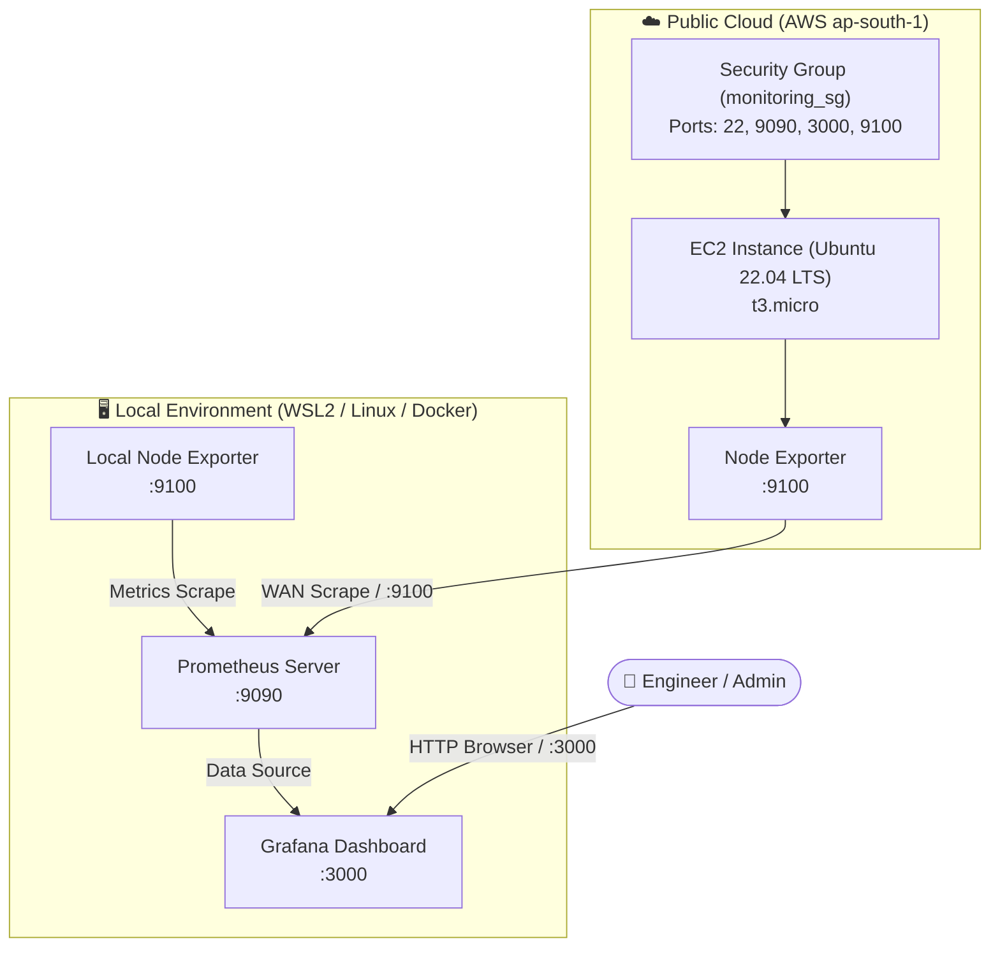

# 🌐 Hybrid Cloud Observability Bridge

[](https://www.terraform.io/)
[](https://aws.amazon.com/)
[](https://www.docker.com/)
[](https://prometheus.io/)
[](https://grafana.com/)
[](https://ubuntu.com/)

A production-style DevOps project demonstrating **Infrastructure as Code (IaC)** and **cross-environment observability**. This project provisions cloud infrastructure on **AWS (ap-south-1)** using Terraform and bridges it with a local workstation / on-premise monitoring stack containerized via **Docker Compose**, tracking real-time health metrics using **Prometheus** and visualizing them in **Grafana**.

---

## 📐 Architecture Overview



### Key Components
1. **Cloud Target (AWS):** An automated EC2 instance running Ubuntu 22.04 LTS, secured by a dedicated security group permitting Prometheus scraping on port `9100`.
2. **Collector (Prometheus):** A containerized time-series database configured to scrape metrics simultaneously from both local workstation containers and cloud infrastructure across the internet.
3. **Visualization (Grafana):** Dynamic, unified visualization layer presenting CPU load, memory utilization, network traffic, and disk I/O across hybrid environments.
4. **Agent (Node Exporter):** Lightweight system metric collector installed on both local and cloud hosts.

---

## 🛠️ Tech Stack

* **Infrastructure as Code:** [Terraform](https://www.terraform.io/) (AWS Provider `~> 5.0`)
* **Cloud Platform:** [Amazon Web Services (AWS)](https://aws.amazon.com/)
* **Containerization:** [Docker](https://www.docker.com/) & [Docker Compose](https://docs.docker.com/compose/)
* **Metrics & Monitoring:** [Prometheus](https://prometheus.io/) & [Node Exporter](https://github.com/prometheus/node_exporter)
* **Visualization:** [Grafana](https://grafana.com/)
* **Host Environment:** Windows Subsystem for Linux (WSL2 / Ubuntu) / VMware / Native Linux

---

## 📂 Project Structure

```text
hybrid-cloud-observability-bridge/
├── terraform/
│   ├── provider.tf        # AWS Provider declaration & version pinning
│   ├── main.tf            # EC2 instance and Security Group definitions
│   └── outputs.tf         # Outputs EC2 Public IP for Prometheus scraping
├── monitoring/
│   ├── docker-compose.yml # Multi-container spec (Prometheus, Grafana, Node Exporter)
│   └── prometheus.yml     # Scrape targets (local & remote cloud endpoints)
├── .gitignore             # Ignores Terraform state and sensitive files
├── LICENSE                # License definition
└── README.md              # Project documentation
```

---

## 🚀 Getting Started

### Prerequisites

Ensure you have the following installed on your machine:
* [Terraform](https://developer.hashicorp.com/terraform/install) (`>= 1.5.0`)
* [AWS CLI](https://aws.amazon.com/cli/) configured with valid credentials (`aws configure`)
* [Docker](https://docs.docker.com/get-docker/) & [Docker Compose](https://docs.docker.com/compose/install/) (or Docker engine running inside WSL2)
* [Git](https://git-scm.com/)

---

### Step 1: Provision AWS Infrastructure with Terraform

1. Navigate to the `terraform/` directory:
   ```bash
   cd terraform
   ```

2. Initialize Terraform and download the required AWS provider plugins:
   ```bash
   terraform init
   ```

3. Review the execution plan:
   ```bash
   terraform plan
   ```

4. Deploy the infrastructure:
   ```bash
   terraform apply -auto-approve
   ```

5. Capture the outputted public IP address:
   ```text
   Apply complete! Resources: 2 added, 0 changed, 0 destroyed.

   Outputs:
   instance_public_ip = "13.232.8.254"
   ```

---

### Step 2: Install Node Exporter on Cloud EC2 Instance

Connect to your EC2 instance via SSH and start Node Exporter:

```bash
# Connect to your cloud instance
ssh -i <your-key.pem> ubuntu@<instance_public_ip>

# Download and run Node Exporter (or use Docker / binary service)
docker run -d --name node-exporter --net=host prom/node-exporter:latest
```

Verify port `9100` metrics are exposed:
```bash
curl http://localhost:9100/metrics
```

---

### Step 3: Update Prometheus Scrape Configuration

1. In `monitoring/prometheus.yml`, update the `cloud-node` target with your provisioned EC2 instance IP:
   ```yaml
   global:
     scrape_interval: 15s
     evaluation_interval: 15s

   scrape_configs:
     - job_name: 'prometheus'
       static_configs:
         - targets: ['localhost:9090']

     - job_name: 'local-node'
       static_configs:
         - targets: ['node-exporter:9100']

     - job_name: 'cloud-node'
       static_configs:
         - targets: ['<YOUR_EC2_PUBLIC_IP>:9100']
   ```

---

### Step 4: Spin Up the Local Monitoring Stack

1. Navigate to the `monitoring/` directory:
   ```bash
   cd ../monitoring
   ```

2. Start Prometheus, Grafana, and local Node Exporter in detached mode:
   ```bash
   docker compose up -d
   ```

3. Verify running containers:
   ```bash
   docker ps
   ```

---

### Step 5: Configure Grafana & Dashboards

1. Open your web browser and navigate to:
   * **Grafana:** `http://localhost:3000` (or `http://<WSL_IP>:3000`)
   * **Prometheus Targets:** `http://localhost:9090/targets`
2. Default Grafana Credentials:
   * **Username:** `admin`
   * **Password:** `admin`
3. Add Prometheus as a Data Source:
   * Go to **Connections > Data Sources > Add data source**.
   * Select **Prometheus**.
   * Set Prometheus server URL to: `http://prometheus:9090`
   * Click **Save & Test**.
4. Import Community Dashboard:
   * Go to **Dashboards > New > Import**.
   * Enter Dashboard ID **`1860`** (*Node Exporter Full*).
   * Select the Prometheus data source and click **Import**.
   * Switch between `local-node` and `cloud-node` instances in the dropdown to observe hybrid infrastructure metrics side-by-side.

---

## 📊 Monitored Metrics

| Metric | Source | Description |
| :--- | :--- | :--- |
| `node_cpu_seconds_total` | Node Exporter | Per-core CPU utilization across modes (user, system, idle, iowait) |
| `node_memory_MemAvailable_bytes` | Node Exporter | Real-time memory pressure and free memory capacity |
| `node_network_receive_bytes_total` | Node Exporter | Inbound and outbound network bandwidth throughput |
| `node_disk_read_bytes_total` | Node Exporter | Storage read/write I/O performance and latency |
| `up` | Prometheus | Binary availability status of monitored cloud & local endpoints |

---

## 🔧 Troubleshooting & Tips

* **WSL2 Localhost Connection Refused:**  
  If Windows does not automatically forward `localhost:3000`, query the WSL internal IP using `hostname -I` and connect directly to `http://<WSL_IP>:3000`.
* **Corrupted Grafana SQLite Database:**  
  If a sudden shutdown or daemon crash prevents Grafana from authenticating (`Unknown error occurred`), wipe the volume cleanly and restart:
  ```bash
  docker compose down -v
  docker compose up -d
  ```
* **AWS Security Group Ingress:**  
  Ensure port `9100` is accessible from your local network's public IP in `terraform/main.tf` if your Prometheus instance fails to scrape `cloud-node`.

---

## 🧹 Resource Cleanup

To avoid unnecessary cloud charges, destroy the AWS resources and stop local containers when done:

```bash
# 1. Stop local containers
cd monitoring
docker compose down -v

# 2. Destroy AWS infrastructure
cd ../terraform
terraform destroy -auto-approve
```

---

## 📄 License

This project is licensed under the terms of the [MIT License](LICENSE).
